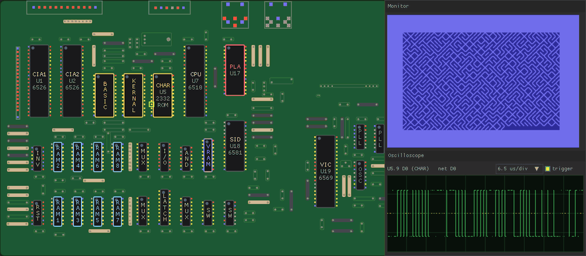

# c64-hw-sim

c64-hw-sim simulates the motherboard of the Commodore 64, ASSY 250407, pin
by pin. You can lift the leg of a chip, short it to ground or to +5V, pull a
chip out of its socket, or open a resistor. Then you watch what the machine
does: the picture on the monitor, the keyboard, every signal on the board.

The program knows the board's netlist (the electrical connections on the
PCB) and how each chip behaves at its pins. It knows nothing about what a
broken Commodore 64 looks like: when you simulate a broken part and the
screen fills with garbage, that garbage was computed from the circuit, not
chosen by someone who knew what to expect.

Here is an example. Lift pin 17 (A7) of the color RAM before power on, and
the machine boots and looks healthy. The CPU writes and the VIC reads with
the same wrong address, so the RAM simply aliases. Put the leg back, and
the half of the color RAM that was never written shows up as random
colors. Lift it again, and the screen is clean. A real 2114 does the same.

With this program you can do mainly two things:

1. Learn how the Commodore 64 works at a more intimate level, in a way that
   is hard to reproduce on real hardware without the risk of damaging it
   (and on most boards many chips are soldered, not socketed).
2. If you have a broken C64 and some hypothesis about what could be broken,
   simulate it with this program and perhaps gain clues, so that you can
   desolder chips in the most logical order, and desolder as few of them as
   possible (desoldering is a boring process, and every time it risks
   damaging the board...). A matching symptom is a clue, not a proof:
   different faults can look the same, and the simulation has its limits
   (see below).

Please note that **even on fast computers** this program struggles to
simulate the C64 hardware at real speed. A real C64 is simulated at 31% of
its speed on an Apple M3 Max, 39% on an AMD Ryzen AI Max+ PRO 495 (Gorgon
Halo), and 48% on an Apple M5 Max. This is not a problem for the goals of
this program, but be warned: it is not an emulator to play games with.

Above: the classic `10 PRINT CHR$(205.5+RND(1));:GOTO 10` maze is running
when the character ROM (U5) is pulled out of its socket, and later put
back. The CPU, the RAM and the program keep working; only the shapes of
the characters are lost, as repairers know well. The scope is on the data
line D0 of the ROM socket: with the socket empty, the bus floats (the
dotted segments) whenever the VIC fetches a character shape. Shown at C64
speed.

## Acknowledgements

I (antirez) got the idea for this program while using and observing Andre
Weissflog's (floooh) chips, emulators of the 6502, VIC-II, CIA, SID and
friends that use pins as their interface. The next step was to take this
approach, with his code as a starting point, to its logical extreme:
pin-level models of every other part of the C64, the RAMs, the ROMs, the
logic chips, the PLA, and so forth.

The chip cores are floooh's chips, taken from c64-llm (zlib license). The
board comes from bwack's C64-250407-Replica-KiCad (CERN OHL). The PLA
equations come from the 82S100 read-out by Mark Smith and Marko Mäkelä.

## Building

    make
    ./c64-hw-sim [program.prg]

It runs on macOS, Linux (X11) and Windows, with OpenGL. On Windows, build
with MinGW-w64 gcc from a POSIX shell (Git Bash or MSYS2), for example
`mingw32-make`, then run `c64-hw-sim.exe`. The graphics library (sokol)
and the interface library (nuklear) are in `third_party/`.

## Using it

The window shows the board, the monitor, a control panel and an
oscilloscope.

Chips are boxes named by role:

- RAM1 to RAM8 are the 4164 DRAMs. Each one holds a single bit of every
  byte: RAMn has data bit n-1.
- VRAM is the 2114 color RAM.
- BASIC, KERNAL and CHAR are the ROMs.
- PLA is the address decoder.

Zoom in to see references and address ranges. Pins show their state as a
logic probe would: red high, blue low, yellow pulsing, gray floating,
magenta when two outputs fight.

Click a pin to put it on the oscilloscope and to break it: floating,
shorted to GND, or shorted to +5V. Click a chip to pull it out. Click a
resistor, a ferrite bead or the crystal to open it. The control panel
lists the faults, each with a repair button.

The control panel also loads .prg files. They are written straight into
the DRAM chips, as a freezer cartridge would do it, so loading works on a
broken board too.

Type on your keyboard as usual. ESC is RUN/STOP, PgUp is RESTORE, TAB is
CTRL, and left ALT is C=.

## Command line

    ./c64-hw-sim --headless 200 --text --shot out.png --fault U17:removed

This runs four seconds (200 frames) without a window. It prints the text
read from the monitor picture, as a person would read it, and saves the
picture. A fault is written `REF:what` or `REF.PIN:what`:

    U17:removed   U21.14:gnd   U12.14:vcc   U9.2:open   R51:open   RP4:short

Other options:

- `--at 150:U6.17:open --at 300:repair` breaks and repairs parts while the
  C64 runs.
- `--nets` reports the nets where outputs fought.
- `C64HW_TYPE=$'PRINT 1+1\n'` types text after boot.
- `C64HW_CHECK=1` checks every KERNAL read and every VIC fetch against the
  ideal memory map.
- `--record 900:DIR --frames 90` (graphical mode) saves the window 90
  times, every 4 emulated frames from frame 900 on. This is how the GIF
  above was made.

`tests/faults.sh` runs 31 common faults. The expected symptom of each one
was written down before the simulator was run.

## How it works

`tools/kicad2c.py` turns bwack's KiCad replica of the 250407 into C tables:
216 parts, their pads, and 249 nets.

Every pin drives its net strongly, weakly (a pull-up), from a supply short,
or not at all. The strongest drive wins. Two equal drives fighting are a
contention, and low wins.

A net that nobody drives keeps its charge, and then drifts:

- to about 1.4V within microseconds, if TTL inputs load it;
- toward 0V in a fraction of a second, if only MOS inputs are on it.

MOS inputs compare that voltage, plus some noise, with their own threshold,
so a floating line can read erratically.

Power faults depend on the chip:

- A chip without VCC is dead.
- A chip without GND lets its outputs float high.
- A CMOS chip keeps running on phantom power, which reaches it through the
  protection diodes of its pins.

The noise is seeded, so a run can be repeated exactly.

`src/parts.c` models these parts at their pins:

- the glue logic;
- the ROMs;
- the DRAMs, which latch the row on /RAS and the column on /CAS;
- the color RAM;
- the PLA, with its real logic equations.

The 6510, VIC-II, CIAs and SID are cycle-accurate cores from floooh's
chips. In `src/board.c` each core sits in a socket that sees only its pins.
Each half cycle runs in three steps: the row address, then /RAS falls,
then /CAS falls. The whole board settles after each step.

PLAN.md explains the reasoning behind these choices.

## Limits

It is slow, between a third and half of real time on the computers listed
above, because every pin of every chip is simulated.

The floating and power models have the right shape, but their numbers
(thresholds, drift times, crosstalk) are guesses. They are constants in
`src/sim.c`.

These analog parts are not simulated: the video output, the SID filter,
the power supply, and the dot clock PLL.

Faults inside a chip, such as bad DRAM cells or slow parts, and bridges
between two nets are planned but not done.
